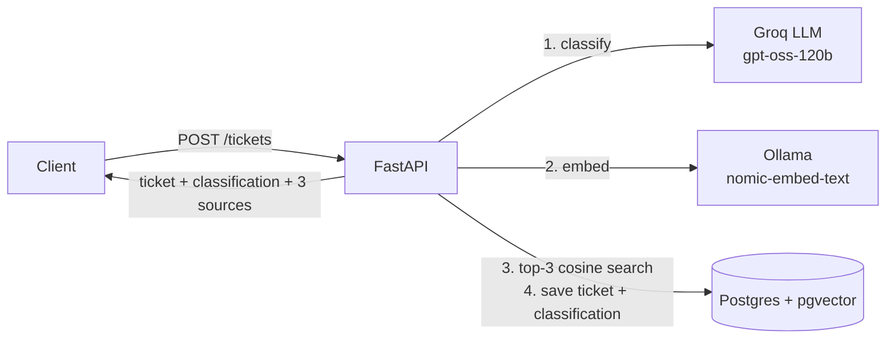

# Ticket Triage API

A FastAPI service that reads an incoming support ticket, classifies its **category** and **urgency** with an LLM, and retrieves the **3 most similar resolved tickets** from a pgvector knowledge base, so an agent can see how similar cases were handled before.

The goal was a measured result, not just a demo. A hand-labelled eval set backs up every number below.

**Stack:** FastAPI · Postgres 16 + pgvector · Groq (`openai/gpt-oss-120b`) · Ollama (`nomic-embed-text`) · Docker Compose

---

## Results

20 held-out tickets (2 per category), never stored in the knowledge base, so retrieval can't find the ticket itself.

| | Category | Urgency | Retrieval hit@3 |
|---|---|---|---|
| Simple baseline (vs. dataset labels) | 10% (random) | 55% (always "medium") | ~27% (3 random tickets) |
| Simple baseline (vs. hand labels) | 25% (always "Technical Support") | 45% (always "low") | – |
| Baseline prompt, vs. **dataset labels** | 25% | 40% | 35% |
| Baseline prompt, vs. **hand labels** | 60% | 85% | – |
| + category definitions, vs. **dataset labels** | 30% | 45% | 35% |
| + category definitions, vs. **hand labels** | **80%** | **80%** | – |

*hit@3 = at least 1 of the 3 retrieved tickets has the correct category. With 20 tickets, 1 ticket = 5 points, so changes of ≤5 points are noise.*

**Cost and latency (measured over 20 eval calls):** about 550 input and 160 output tokens per ticket, which is **about $0.00018 per ticket** (roughly $0.18 per 1,000) at Groq's price for gpt-oss-120b ($0.15 / $0.60 per 1M input / output tokens, checked 2026-11-14). LLM latency: 0.75 s median, 1.5 s mean. Embedding: 80 ms median.

### What I found

- **The dataset labels are noisy.** I hand-labelled the 20 eval tickets blind, using written rules. My labels agreed with the dataset on only **40% of categories and 30% of urgencies**. The model's ~30% against the dataset is about what a careful human gets, so I score against both answer keys.
- **Against sensible labels the model does well:** 60% category and 85% urgency with the same prompt. Only the answer key changed.
- **Defining each category in the prompt raised category accuracy from 60% to 80%.** The dataset-label score barely moved, as you'd expect: definitions can't predict noisy labels.
- **`temperature=0` matters.** At the default temperature, 6 of 20 predictions changed between identical runs. At 0 only 1 changed. That isn't 0 because of GPU batching and the reasoning model.
- **Retrieval only just beats random (35% vs. ~27%).** Clear topics like billing retrieve well, but many labels follow the dataset's routing habits more than what the ticket says.

---

## How it works



### Design decisions

- **Validated LLM output.** The model must return JSON, Pydantic checks it against enums, and a failure gets 1 retry. If the retry also fails, a safe fallback is used (`General Inquiry` / `medium` / confidence `0`), so a bad response never crashes the endpoint.
- **All AI calls live in `llm.py`**, with retries (tenacity), timeouts, and latency and token logging on every call. The provider is any OpenAI-compatible API, chosen by env vars.
- **pgvector instead of a separate vector DB.** Tickets, labels and vectors live in one Postgres database, so retrieval is a plain SQL join.
- **No eval leakage.** Eval tickets are never stored, so retrieval can't score a hit by finding the ticket itself.

---

## Quickstart

**Requirements:** Docker, [Ollama](https://ollama.com) running on the host, and a [Groq API key](https://console.groq.com).

```bash
git clone https://github.com/krishkhatrii/ticket-triage.git
cd ticket-triage

ollama pull nomic-embed-text
cp .env.example .env            # add your OPENAI_API_KEY

docker compose up -d --build
docker compose exec api python -m app.seed   # loads 150 resolved tickets + embeddings
docker compose exec api python -m app.eval   # prints the eval table
```

Swagger UI: http://localhost:8000/docs

## API

| Method | Path | What it does |
|---|---|---|
| `GET` | `/health` | Liveness check |
| `POST` | `/tickets` | Classify + retrieve 3 similar tickets, then store |
| `GET` | `/tickets/{id}` | Fetch one ticket |
| `GET` | `/tickets?status=open` | List tickets, optionally by status |

```bash
curl -X POST http://localhost:8000/tickets \
  -H "Content-Type: application/json" \
  -d '{"subject": "Charged twice this month", "body": "My card was billed twice for the same subscription. Please refund one."}'
```

```json
{
  "ticket": { "id": 153, "subject": "Charged twice this month", "status": "open", "...": "..." },
  "classification": { "category": "Billing and Payments", "urgency": "high", "confidence": 0.99 },
  "sources": [
    {
      "ticket_id": 35,
      "subject": "Problem with Recent Subscriptions Showing Double Charges",
      "answer": "Dear [Name], we apologize for the billing issues you are experiencing with double charges...",
      "similarity": 0.736
    },
    { "ticket_id": 44, "subject": "Discrepancy in Billing Found", "answer": "...", "similarity": 0.626 },
    { "ticket_id": 45, "subject": "Discrepancies in Billing for Linked SaaS Products", "answer": "...", "similarity": 0.602 }
  ]
}
```

---

## Data

[`Tobi-Bueck/customer-support-tickets`](https://huggingface.co/datasets/Tobi-Bueck/customer-support-tickets) (Hugging Face), filtered to English tickets with every field present. With a fixed seed (42), 15 tickets per category go into the knowledge base and 2 per category into the eval set.

- `data/eval_dataset_labels.json`: eval tickets with the dataset's labels
- `data/eval_hand_labels.json`: my hand labels for the same tickets

---

## Limitations

- Small eval set: 20 tickets, so 1 ticket = 5 points.
- hit@3 uses the noisy dataset labels.
- If Groq or Ollama is down, the ticket is not saved.
- No migrations. Schema changes need a re-seed.
- No tests, auth or CI yet.
